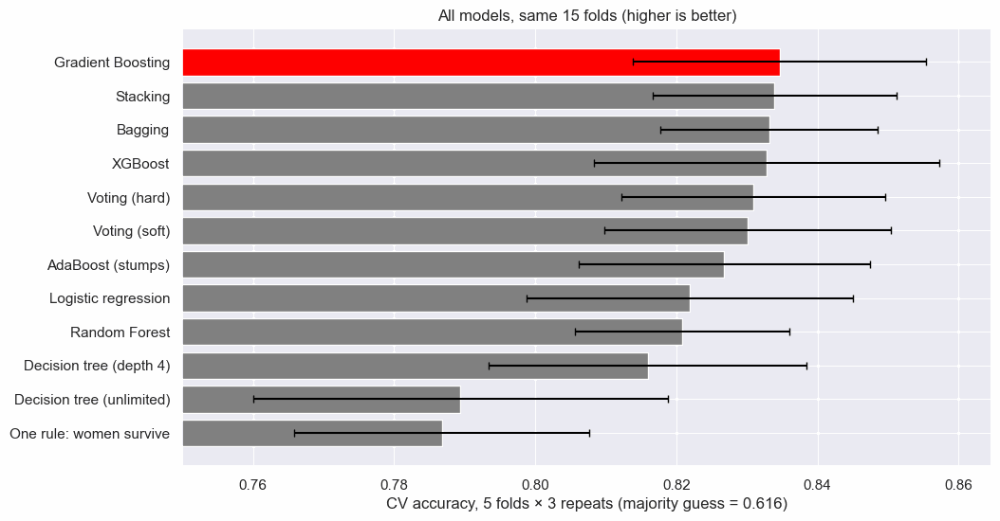
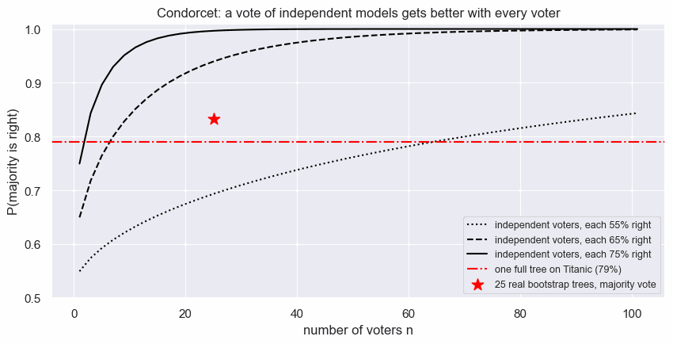
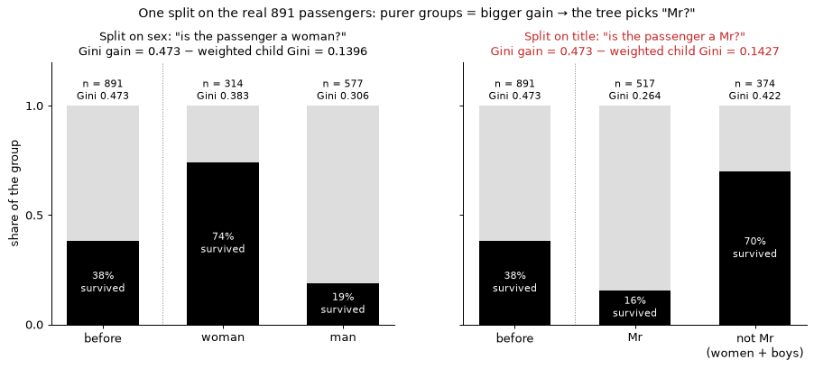
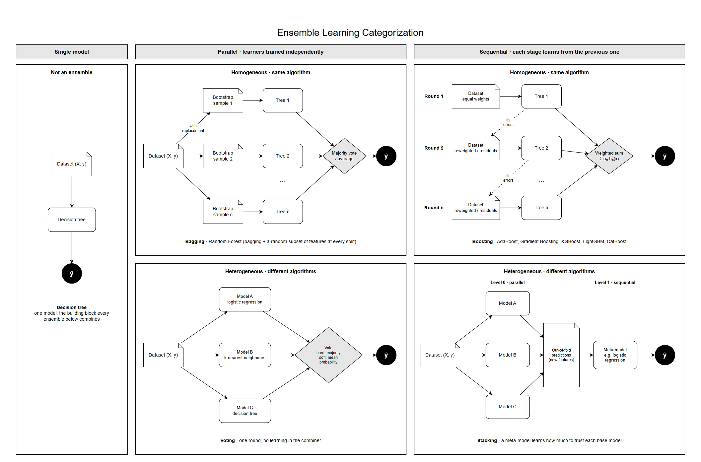
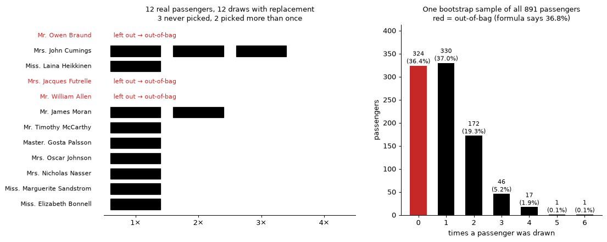
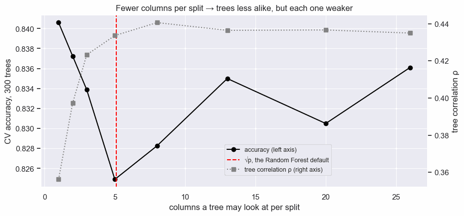
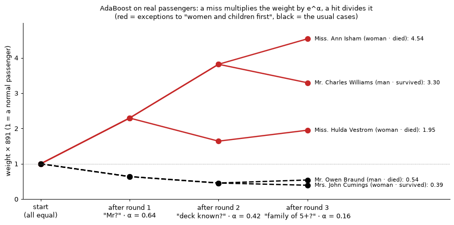
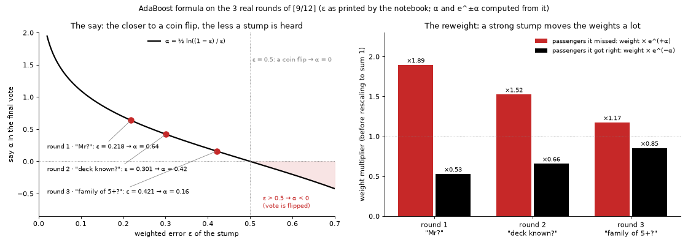
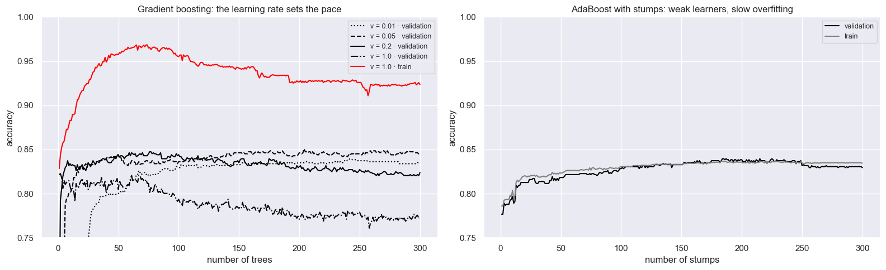
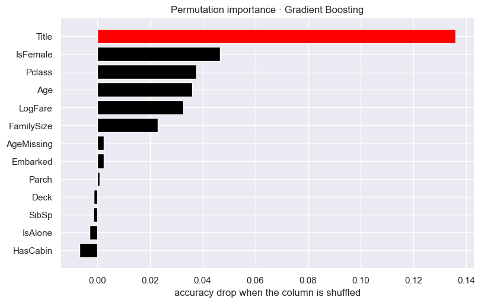

# Everything about Ensemble Learning (Exploited)

## Objective

- **Problem** → "just try XGBoost" is how most people pick an ensemble; when it wins or loses, nobody knows why
- **Why this repo** → grow one decision tree into every kind of ensemble (bagging, Random Forest, boosting, voting, stacking), measure what each one fixes (variance or bias), and score them all on the same folds
- **Real-world use** → a decision guide for small tabular problems such as churn, credit scoring or lead scoring: which ensemble to try first, which knob matters, and how to compare models fairly

## Highlights

**Question:** does any ensemble beat one simple rule?

**Answer:** yes, by about 5 points. "Women survive" scores 78.7 %; Gradient Boosting, Stacking, Bagging and XGBoost all land at 83.3-83.5 %, a statistical tie, so the cheapest one to maintain is a fine choice.

**Question:** why does a crowd of trees not reach 98 %?

**Answer:** the trees make the same mistakes. 51 independent voters at 65 % would be right 98.6 % of the time; 25 real trees reach only 83.2 % because their errors correlate (0.64-0.81 between model types).

**Question:** what decided survival?

**Answer:** title (Mr / Mrs / Miss / Master) first, then sex and class.

| Feature (permutation importance) | Accuracy lost when shuffled |
|---|---|
| Title | 13.6 points |
| Sex | 4.7 |
| Class | 3.8 |
| Age | 3.6 |
| Fare | 3.3 |

## [1/9] Overview

- **Data** → [Titanic: Machine Learning from Disaster](https://www.kaggle.com/competitions/titanic) · 891 passengers with outcome · 418 to predict
- **Task** → survived (1) / died (0)
- **Metric** → accuracy (the competition score), ROC-AUC alongside
- **Notebook** → `ensemble_learning_titanic.ipynb`
- **Idea** → grow one decision tree into every kind of ensemble, work out *why* each one helps, and score them all on the same 15 folds
- **Result** → Gradient Boosting **83.5%**, Stacking 83.4%, Bagging 83.3%, XGBoost 83.3% (a statistical tie) vs 78.7% for "women survive"

| Model (5 folds × 3 repeats) | CV accuracy | ROC-AUC | Train − CV gap |
|---|---|---|---|
| Majority guess (everyone dies) | 61.6% | 0.500 | 0 |
| One rule: women survive | 78.7% | 0.767 | 0 |
| Decision tree, unlimited | 78.9% | 0.775 | 20.0 |
| Decision tree, depth 4 | 81.6% | 0.848 | 3.3 |
| Random Forest | 82.1% | 0.875 | 9.0 |
| Logistic regression | 82.2% | 0.871 | 1.5 |
| AdaBoost (stumps) | 82.7% | 0.869 | 1.0 |
| Voting (soft / hard) | 83.0% / 83.1% | 0.879 / — | 6.0 |
| XGBoost | 83.3% | 0.874 | 7.2 |
| Bagging | 83.3% | 0.872 | 10.3 |
| Stacking | 83.4% | 0.879 | 7.2 |
| **Gradient Boosting** | **83.5%** | 0.877 | 9.9 |

## [2/9] Run on Kaggle

- **Title** → Everything about Ensemble Learning (Exploited)
- **Import** → Create → Import Notebook → upload the `.ipynb`
- **Input** → competition `titanic`
- **Accelerator** → none (CPU, about 3 minutes)
- **Settings** → top cell of the notebook, documented in its note
- **Safety** → `SAVE_SUBMISSION = False` → previews the predictions, writes nothing
- **Diagram** → embedded in the notebook as an attachment, no extra file needed

## [3/9] Data and features

- **Gaps** → `Cabin` 77%, `Age` 20%, `Embarked` 2 passengers; the gaps predict survival (no cabin 30% vs 67%) → flags instead of dropping
- **Patterns** → women 74% vs men 19% · 1st class 63% vs 3rd 24% · women in 3rd class only 50%
- **Features** → `Title` (Mr / Mrs / Miss / Master / Rare), `FamilySize`, `IsAlone`, `Deck`, `HasCabin`, `LogFare`, `AgeMissing` → 26 model columns
- **Leakage** → imputation, one-hot and scaling live in a scikit-learn pipeline, refit per fold

## [4/9] One decision tree

- **A split in one line** → try every yes/no question, keep the one that leaves the purest groups (Gini / entropy)
- **Best first split** → "is the passenger a Mr?" (Gini gain 0.143), slightly ahead of sex (0.140): it also moves the boys to the women's side
- **Gain, part by part** → mix before (0.473) − size-weighted mix after (0.330) → greedy, one column at a time, and only tiny groups are pure → why a deep tree memorises
- **Depth** → best at 4 (81.6%); an unlimited tree scores 98.9% on training passengers and 78.9% on new ones
- **Instability** → 25 bootstrap trees score 74.9-84.4% on the same passengers and disagree on 69% of them; their vote scores 83.2%

## [5/9] Ensemble categorization

- **Parallel + same algorithm** → bagging, Random Forest → lower variance
- **Sequential + same algorithm** → boosting → lower bias
- **Parallel + different algorithms** → voting
- **Different algorithms, then a meta-model** → stacking
- **Source** → `assets/ensemble_categorization.drawio` (editable in draw.io)
- **Why a crowd works** → Condorcet's jury theorem: 51 independent voters at 65% would be right 98.6% of the time; 25 real trees reach 83.2% because they make the same mistakes

## [6/9] Bagging and Random Forest

- **Bootstrap** → draw 891 passengers out of 891, putting each back → $(1 - 1/n)^n \approx 36.8\%$ left out per tree → out-of-bag accuracy 82.6% vs CV 82.1%
- **Variance** → $\rho\sigma^2 + \frac{1-\rho}{B}\sigma^2$ → more trees only shrink the unshared part $\frac{1-\rho}{B}\sigma^2$; the shared part $\rho\sigma^2$ (tree correlation) sets the floor, which Random Forest tries to lower by hiding columns
- **Finding** → on Titanic √p columns per split does not decorrelate the trees (ρ 0.43 vs 0.44 for bagging); 1 column per split is best (84.1%, ρ 0.36)
  - the signal sits in title, sex and class → hiding them weakens each tree, while substitutes keep the trees alike

## [7/9] Boosting

- **AdaBoost** → round 1 "Mr?" (α 0.64), round 2 "deck known?" (α 0.42), round 3 "family ≥ 5?" (α 0.16)
  - $\alpha = \frac12 \ln\frac{1-\varepsilon}{\varepsilon}$ → 0 for a coin-flip stump; missed passengers × $e^{\alpha}$ (about 1.9 in round 1), so after rescaling they hold exactly half the weight
  - after 3 rounds, women who died (9% of passengers) carry 18% of the weight, men who survived 12% → 25%
- **Gradient boosting** → $F_m = F_{m-1} + \nu h_m$, each small tree fitted to the residuals $y - \hat p$ → learning rate 0.05 peaks at 85.1% (tree 204); 1.0 peaks at tree 2 and falls to 77.2%
- **Stumps** → AdaBoost's train and validation stay within 1 point

## [8/9] Voting, stacking and the winner

- **Diversity** → base-model mistakes correlate 0.64-0.81; 97 passengers fool all 4 models (91 are men who survived or women who died)
- **Voting** → 83.0-83.1%, below its best member: the fixed 1/K weights let weaker models outvote it
- **Stacking** → a logistic regression trained on out-of-fold predictions weights Gradient Boosting highest (2.49 vs 0.54 for logistic regression) → 83.4% with the smallest fold spread
- **Importance** → title 13.6 points, sex 4.7, class 3.8, age 3.6, fare 3.3

## [9/9] Next steps

- **Leaderboard check** → submit and compare the public score with the cross-validated 83.5%
- **Ticket groups** → shared tickets as a group-survival feature, built inside each fold
- **More randomness** → `ExtraTreesClassifier`, `max_features` 1-2
- **Tuning** → randomised search for gradient boosting inside nested cross-validation
- **Calibration** → do soft-vote probabilities mean what they say?
